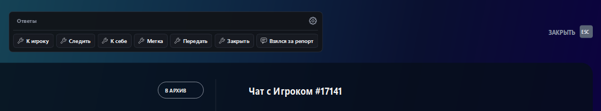
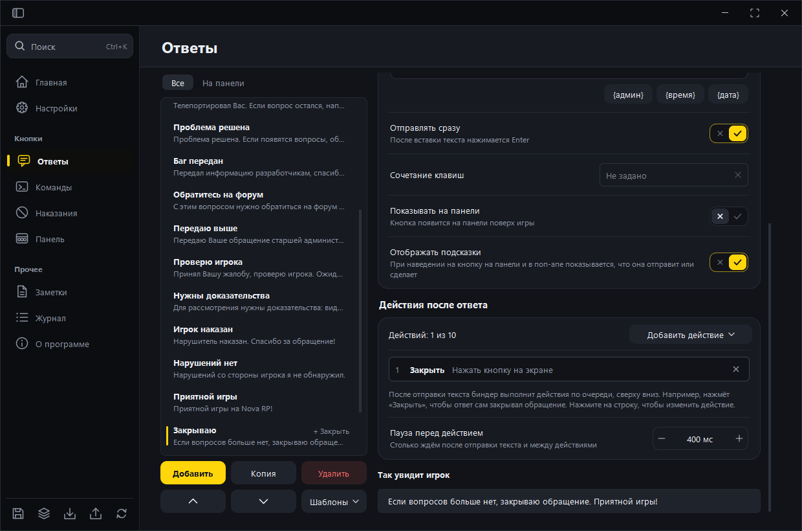
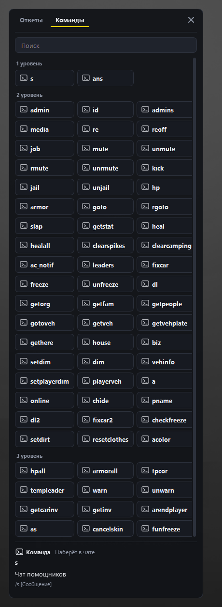
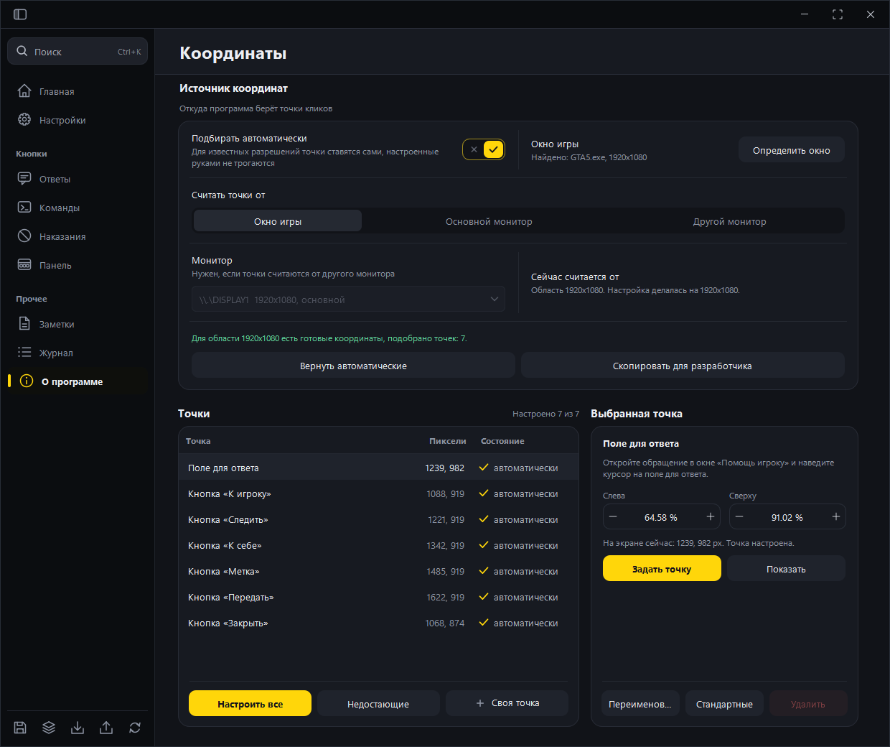
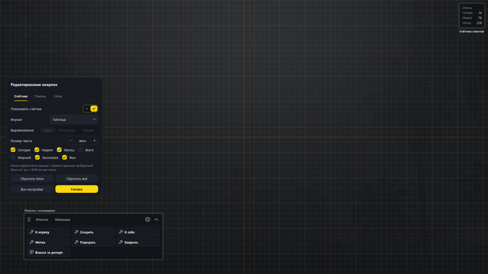
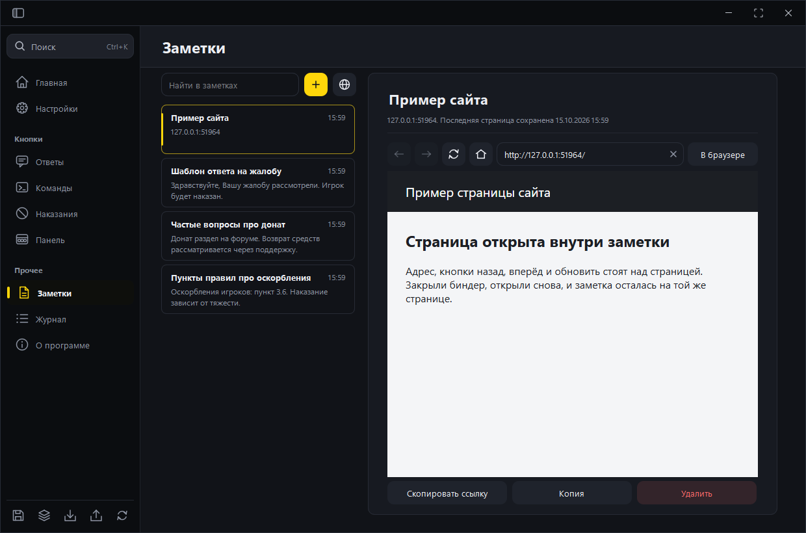
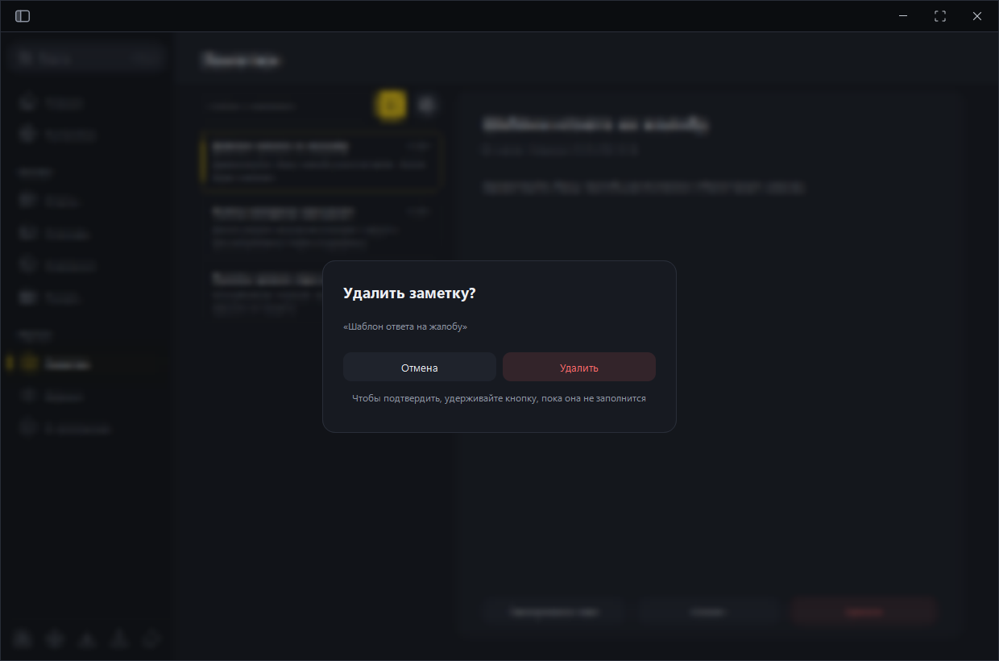
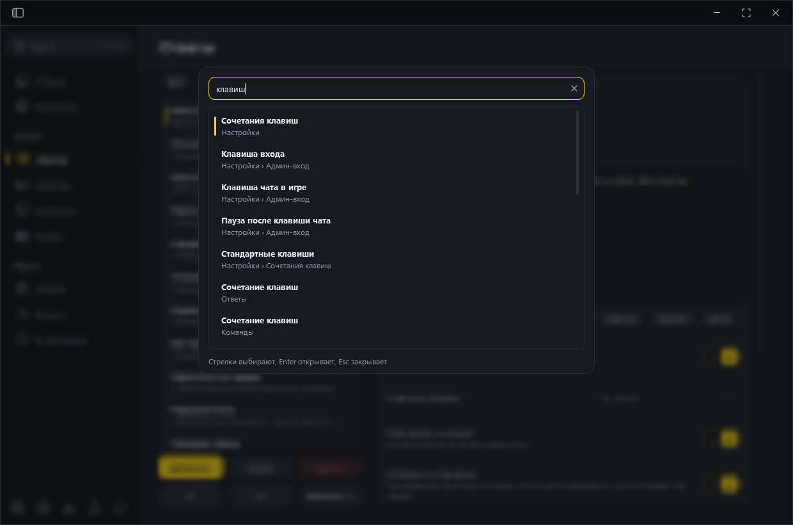
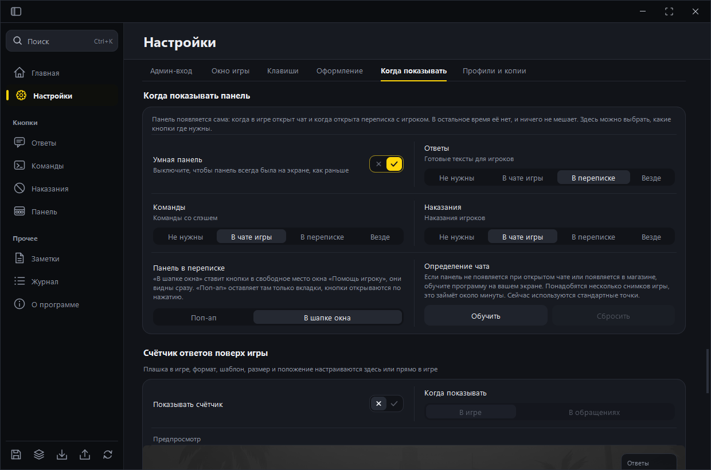
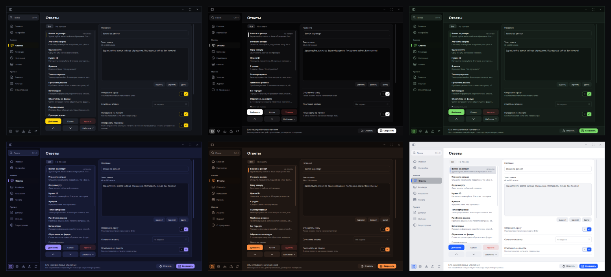

# Nova Binder

Программа для администраторов Nova RP. Лежит поверх игры и сводит работу в окне «Помощь игроку» к одному нажатию. Готовый ответ вставляется и отправляется, кнопки действий нажимаются сами, команды уходят в чат.

## Зачем я это написал

За смену админ отвечает на десятки обращений, и почти каждый ответ повторяется. Каждый раз нужно открыть обращение, набрать текст, отправить, потом нажать «Следить» или «Закрыть». Руки делают одно и то же сотни раз.

Я собрал инструмент, который берёт эту рутину на себя. Он стоит поверх игры, не забирает у неё фокус и появляется сам, когда открыт чат или переписка с игроком. Когда админ занят чем-то другим, панели не видно.

Память игры программа не читает, в процесс ничего не внедряет и перехватчиков не ставит. Она смотрит на экран и посылает нажатия мыши и клавиатуры средствами Windows, то есть делает то, что сделал бы человек за компьютером.

## Что умеет

### Панель в окне «Помощь игроку»

Окно обновилось, и кнопки действий теперь стоят над полем ответа. Панель встаёт в свободное место шапки, поэтому ничего не закрывает. В чате игры она ложится под строку ввода. Положение считается от размера окна игры, ручных координат для обычных разрешений не нужно.

### Ответы и действия после ответа

Ответ это текст, который можно собрать из подстановок вроде имени админа, времени и даты. К ответу привязываются действия. Например, «Закрываю обращение» сначала отправляет текст, потом нажимает «Закрыть». Для самых частых ответов назначается клавиша, скажем Shift и цифра. Программа проверяет, не занята ли она другим действием.

### Команды и наказания

В каталоге 68 команд сервера. Нужная находится поиском, параметры спрашиваются перед отправкой. Для наказаний хранятся причины и сроки.

### Координаты без ручной возни

Положение кнопок считается по раскладке окна «Помощь игроку» для любого размера окна от 1024 на 576. Руками ничего снимать не нужно. Если интерфейс игры изменится и точка попадёт не туда, её можно переснять мастером. Он просит навести курсор на нужное место и нажать клавишу, дальше всё запоминается.

### Статистика

Диаграмма ответов по дням, сравнение с прошлым периодом, время в игре, ошибки. Счётчик ответов можно вывести плашкой поверх игры. Формат, шаблон, размер текста и набор периодов выбираются в настройках, а перенести плашку и панель можно мышью прямо в игре, в редакторе с сеткой на Ctrl+F7.

### Редактор оверлея

Клавиша настроек в игре (по умолчанию Ctrl+F7) открывает редактор поверх игры. Окно затемняется, появляется сетка, а счётчик и панель переносятся мышью. Привязка к сетке, направляющие и шаг сетки настраиваются в карточке, формат счётчика меняется там же. Все изменения сохраняются сразу.

### Заметки со встроенным браузером

В заметке можно открыть сайт прямо в программе. Для этого есть два готовых места, правила проекта на форуме и админская панель, и любой свой адрес. Закрыли программу, открыли снова, и заметка осталась на той странице, где вы остановились. Вход на сайт запоминается, если сайт сам его запоминает.

### Настройки

Все параметры собраны на одной странице с переходами по разделам. Тем шесть, панель можно двигать, менять размер, шрифт и прозрачность.

### Подтверждения

Вопросы вроде «Удалить заметку?» не открываются отдельным окном. Карточка встаёт по центру внутри программы, фон под ней размыт. Чтобы удалить что-то важное, кнопку нужно удерживать около секунды, и случайный щелчок ничего не сломает.

### Поиск по программе

Настроек много, и найти нужную не всегда просто. Поиск открывается на Ctrl+K или из бокового меню. Достаточно ввести слово из названия или пояснения. Программа покажет, на какой странице и в каком блоке это лежит, откроет её и подсветит строку.

## Как поставить

1. Скачайте [установщик](https://github.com/debumich/novabinder-releases/releases/latest/download/NovaBinder.exe) и запустите его.
2. Он поставит программу, запустит её и положит ярлык на рабочий стол.
3. Игра должна идти в оконном режиме без рамки.

Windows может написать, что издатель неизвестен. Сертификат для подписи установщика стоит денег, поэтому его пока нет. В таком окне нажмите «Подробнее», потом «Выполнить в любом случае».

Программа просит права администратора. Без них Windows не пускает нажатия в игру, если она сама запущена от администратора.

Новые версии программа находит сама и предлагает поставить. Заново скачивать установщик не нужно.

## Как это устроено

Проект на Python 3.12 и PySide6 6.11, около 32 тысяч строк кода и столько же строк тестов.

Окна рисуются собственным набором виджетов. Кнопки, переключатели, поля, диаграмма и списки написаны с нуля, потому что стандартные виджеты Qt не давали нужного вида и анимаций. Набор лежит отдельным пакетом, страницы настроек собираются из него.

Работа с Windows идёт через ctypes. Нажатия делает SendInput, глобальные клавиши регистрирует RegisterHotKey, состояние экрана читается по цвету нескольких пикселей. Всё это спрятано за интерфейсом, поэтому в тестах стоит подставной слой ввода и игра для проверки не нужна.

Кнопка превращается в план, список простых операций. План строится отдельно от выполнения, его можно проверить без единого клика.

Профили хранятся в JSON с версией формата. Старые профили приводятся к новому виду, профиль из более новой версии отклоняется с понятным сообщением, а повреждённый файл восстанавливается из копии. Пароль админа шифруется средствами Windows и не попадает ни в экспорт, ни в резервные копии.

Обновления идут через этот репозиторий. Список версий подписан ключом Ed25519, программа проверяет подпись и сумму SHA-256 установщика и только потом ставит его. Установщик собирает GitHub Actions из PyInstaller и Inno Setup.

Встроенный браузер работает на Qt WebEngine и запускается только тогда, когда открывают заметку с сайтом, поэтому обычная работа программы его не затрагивает.

Исходный код хранится в закрытом репозитории.

## Связь в Discord

Вопросы и пожелания можно написать мне, ник debum.

Автор Lunar Stellar.
